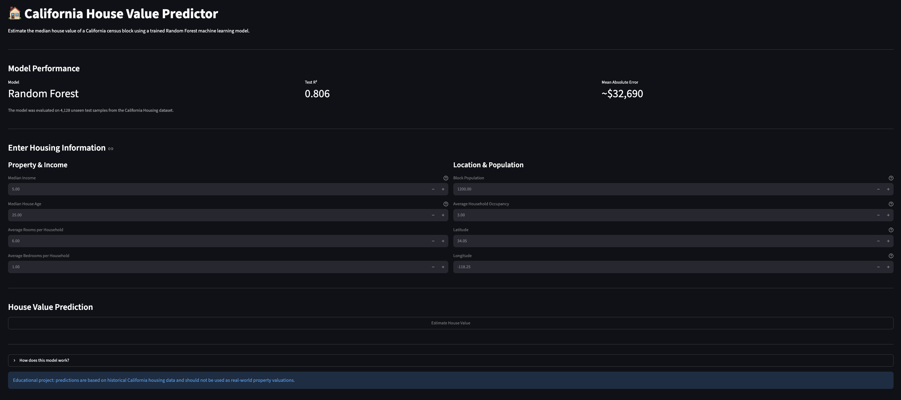

# 🏠 California House Value Predictor

An end-to-end machine learning project that predicts median house values for California census blocks using historical housing data.

The project covers the full machine learning workflow, including data exploration, train-test splitting, baseline modelling, model comparison, feature importance, cross-validation, hyperparameter tuning, model persistence and deployment through an interactive Streamlit application.

## Application Preview



## Project Overview

The goal of this project was to build a regression model capable of predicting median house values using the California Housing dataset from scikit-learn.

The project began with Linear Regression as a baseline model. A Random Forest Regressor was then trained and compared against the baseline.

The Random Forest achieved substantially better predictive performance and was selected as the final model.

The trained model was saved using Joblib and connected to a Streamlit web application where users can enter housing and location information to generate a prediction.

## Machine Learning Workflow

The project follows these main stages:

1. Load and explore the California Housing dataset
2. Check the dataset for missing values
3. Separate the input features from the target variable
4. Split the data into training and testing sets
5. Train a Linear Regression baseline
6. Train and evaluate a Random Forest Regressor
7. Compare model performance
8. Analyse feature importance
9. Check for overfitting
10. Perform 5-fold cross-validation
11. Experiment with hyperparameter tuning
12. Save the final trained model
13. Load the model independently for inference
14. Connect the model to an interactive Streamlit application

## Dataset

The project uses the California Housing dataset provided by scikit-learn.

The dataset contains 20,640 samples.

The model uses eight input features:

- `MedInc` - Median income
- `HouseAge` - Median house age
- `AveRooms` - Average rooms per household
- `AveBedrms` - Average bedrooms per household
- `Population` - Census block population
- `AveOccup` - Average household occupancy
- `Latitude` - Geographical latitude
- `Longitude` - Geographical longitude

The target variable is:

- `MedHouseVal` - Median house value

The data was split into:

- 16,512 training samples
- 4,128 test samples

## Model Comparison

Two regression models were compared.

| Model | MAE   | RMSE | R² |
|-------|-----:|---:|---:|
| Linear Regression | 0.5332 | 0.7456 | 0.5758 |
| Random Forest | 0.3269 | 0.5044 | 0.8058 |

The Random Forest significantly outperformed the Linear Regression baseline and was therefore selected as the final model.

The Random Forest's MAE corresponds to approximately $32,690 because the target values in the California Housing dataset are represented in units of $100,000.

## Cross-Validation

The final Random Forest model was evaluated using 5-fold cross-validation.

Results:

- Mean R²: 0.8051
- Standard deviation: 0.0052

The low variation between folds suggests that the model performs consistently across different subsets of the training data.

## Overfitting Check

The final model produced:

- Training R²: 0.9742
- Test R²: 0.8058
- R² gap: 0.1683

The higher training score shows that the Random Forest fits the training data more closely than unseen data. Cross-validation was therefore also used to evaluate whether performance remained consistent across different data splits.

## Feature Importance

The Random Forest identified median income as the most influential feature.

The feature importance results were approximately:

| Feature | Importance |
| MedInc | 0.526 |
| AveOccup | 0.138 |
| Latitude | 0.089 |
| Longitude | 0.088 |
| HouseAge | 0.054 |
| AveRooms | 0.044 |
| Population | 0.031 |
| AveBedrms | 0.030 |

This showed that median income contributed the most to the model's predictions, while geographical location and household occupancy were also important.

## Hyperparameter Tuning

During development, GridSearchCV was used to test combinations of:

- Number of trees (`n_estimators`)
- Maximum tree depth (`max_depth`)
- Minimum samples required to split a node (`min_samples_split`)

The best configuration found was:

```python
n_estimators=200
max_depth=None
min_samples_split=2
```

The tuned model produced only a small improvement over the original Random Forest, demonstrating that the initial model was already performing strongly.

The final training pipeline therefore uses 200 trees directly instead of rerunning GridSearchCV every time the project is executed.

## Model Persistence

The final trained model is saved using Joblib:

```text
model/random_forest_model.pkl
```

This allows the model to be loaded later without retraining it.

The `test_model.py` script demonstrates this by loading the saved model and performing inference on new input data.

## Streamlit Application

The project includes an interactive Streamlit application.

Users can enter:

- Median income
- Median house age
- Average rooms
- Average bedrooms
- Population
- Average household occupancy
- Latitude
- Longitude

The application converts the inputs into the same feature structure used during training and passes them to the saved Random Forest model.

The resulting prediction is then displayed as an estimated median house value.

Input ranges are restricted to values represented by the training dataset to reduce unrealistic inputs.

## Project Structure

```text
machine-learning-project/
│
├── model/                         # Generated locally after training
│   └── random_forest_model.pkl    # Not committed to GitHub
│
├── app.py
├── ml_project.py
├── test_model.py
├── requirements.txt
├── .gitignore
└── README.md
```

### File Descriptions

- `ml_project.py` - Loads the data, trains and evaluates the models, performs cross-validation and saves the final Random Forest model.
- `app.py` - Streamlit web interface for making predictions with the saved model.
- `test_model.py` - Loads the saved model independently and performs a test prediction.
- `model/random_forest_model.pkl` - Saved trained Random Forest model.
- `requirements.txt` - Python dependencies required to run the project.
- `.gitignore` - Prevents unnecessary local files and environments from being committed.

## Installation

Clone the repository and move into the project directory.

Create a virtual environment:

```bash
python3 -m venv venv
```

Activate it on macOS/Linux:

```bash
source venv/bin/activate
```

Install the dependencies:

```bash
pip install -r requirements.txt
```

## Training the Model

The trained Random Forest model is not stored in the GitHub repository because the generated model file is approximately 276 MB.

Before running the application for the first time, train and save the model:

```bash
python ml_project.py
```

This creates:

```text
model/random_forest_model.pkl
```

The training script also evaluates the models, performs cross-validation and displays the Actual vs Predicted graph.

## Running the Application

Once the trained model has been created, start the Streamlit application:

```bash
python -m streamlit run app.py
```

Then open the local address provided by Streamlit in your browser.

## Testing the Saved Model

To test the saved model independently:

```bash
python test_model.py
```

This verifies that the trained model can be loaded and used for inference without retraining.

## What I Learned

This project helped me understand how the individual stages of a machine learning project connect together.

Key concepts covered include:

- Supervised machine learning
- Regression
- Features and target variables
- Training and testing data
- Linear Regression
- Random Forests
- MAE, RMSE and R²
- Overfitting
- Cross-validation
- Feature importance
- Hyperparameter tuning
- Model persistence
- Inference
- Input validation
- Streamlit application development
- Python virtual environments

One of the main lessons from the project was that training a model is only one part of the machine learning workflow. A useful ML system also requires reliable evaluation, model persistence, reproducible dependencies and a way for users or other applications to interact with the trained model.

## Disclaimer

This project is for educational and portfolio purposes.

The model uses historical California housing data and should not be used as a real-world property valuation tool.